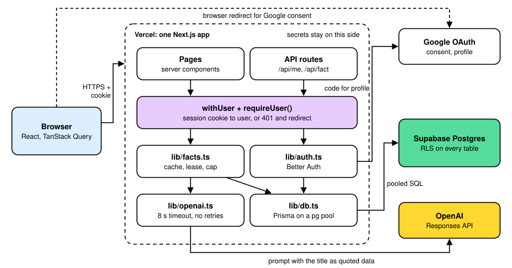
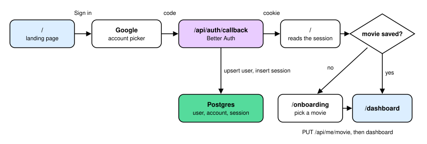
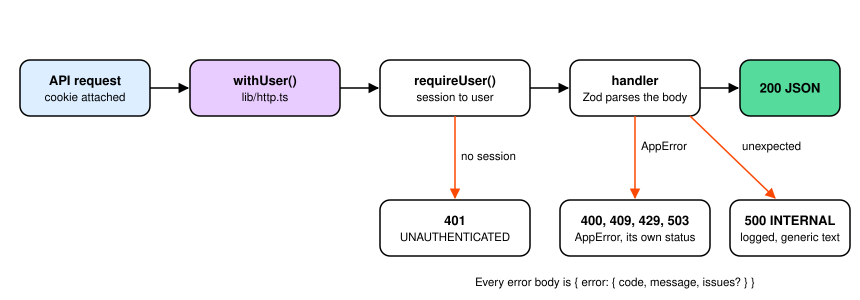
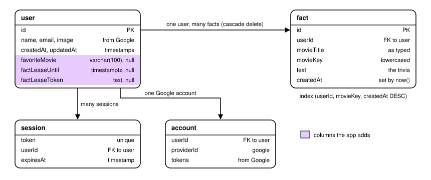
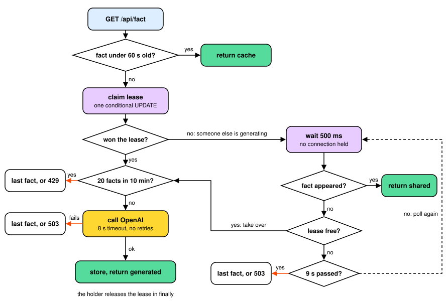
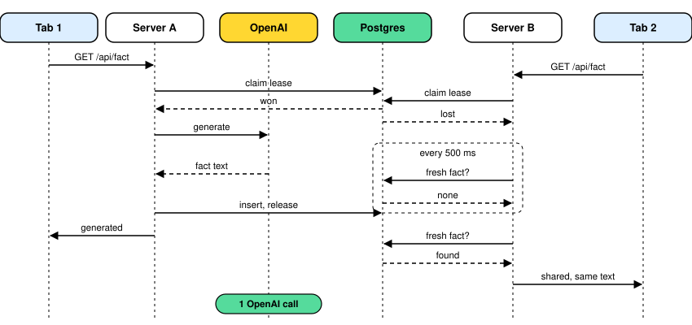
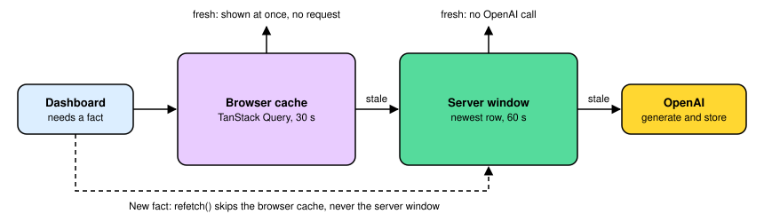
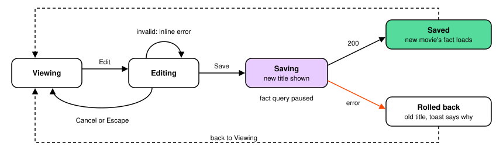
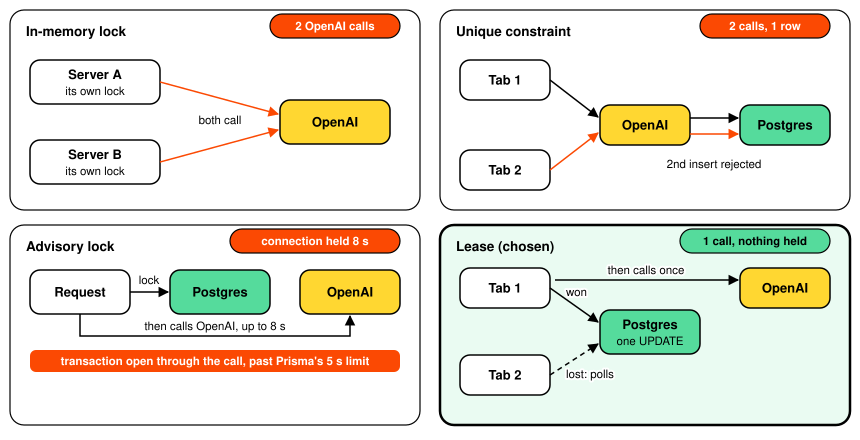

<p align="center">
  
</p>

<h1 align="center">Pandoras Box</h1>

<p align="center">Sign in with Google, name your favorite movie, and get a piece of AI-generated trivia about it. Ask for another fact once a minute.</p>

<!-- Replace VIDEO_ID (twice) with the YouTube video ID, the same one set in app/docs/page.tsx. GitHub blocks iframes, so the thumbnail links out to YouTube. -->
<p align="center">
  <a href="https://www.youtube.com/watch?v=VIDEO_ID">
    
  </a>
  <br>
  <sub>Walkthrough video: the app, the schema, the lease and the failure handling. Click to watch on YouTube.</sub>
</p>

<!-- Add the live URL here after deploy. -->

## What it does

- **Landing:** sign in with Google.
- **Onboarding:** first-time users name one favorite movie. The server validates it.
- **Dashboard:** your Google name, email and photo, your movie, and an AI fact printed on a movie ticket. You can edit the movie in place.
- **Facts:**
  - The server reuses a fact for 60 seconds. Two tabs refreshing at once still make only one OpenAI call.
  - If OpenAI fails, you get your last fact instead of an error.
  - The browser reuses a fact for 30 seconds, and the New fact button counts down to the next one.

## Run it locally

You need Node 24 or later, pnpm 12, and Docker.

1. Install dependencies. This also generates the Prisma client.
   ```bash
   pnpm install
   ```
2. Copy the env file and fill in the values marked `replace-me` (see the table below).
   ```bash
   cp .env.example .env
   ```
   - `BETTER_AUTH_SECRET`: run `openssl rand -base64 32`.
   - `GOOGLE_CLIENT_ID` and `GOOGLE_CLIENT_SECRET`: create a Web OAuth client in Google Cloud Console with the redirect URI `http://localhost:3000/api/auth/callback/google`.
   - `OPENAI_API_KEY`: from your OpenAI project.
3. Start Postgres and apply the migrations.
   ```bash
   pnpm db:up
   pnpm db:migrate
   ```
4. Start the app and open http://localhost:3000.
   ```bash
   pnpm dev
   ```

### Environment variables

| Name | Used by | Value |
|---|---|---|
| `DATABASE_URL` | The app at runtime | Local: the Docker database from `.env.example`. Production: Supabase's transaction pooler URL. |
| `DIRECT_URL` | Prisma migrations | Local: same as `DATABASE_URL`. Production: Supabase's session pooler URL. |
| `TEST_DATABASE_URL` | Backend tests | A separate database. The test setup creates it if it's missing. |
| `BETTER_AUTH_SECRET` | Better Auth | 32 or more random bytes. Signs the session cookie. |
| `BETTER_AUTH_URL` | Better Auth | The app's origin, such as `http://localhost:3000`. |
| `GOOGLE_CLIENT_ID` | Better Auth | Google Cloud OAuth client. |
| `GOOGLE_CLIENT_SECRET` | Better Auth | Google Cloud OAuth client. |
| `OPENAI_API_KEY` | `lib/openai.ts` | Server only. |
| `OPENAI_MODEL` | `lib/openai.ts` | Optional. Defaults to `gpt-5.4-mini`. |

None of these use the `NEXT_PUBLIC_` prefix, and every module that reads one imports `server-only`. No secret can end up in the browser bundle.

### Database migrations

Migrations live in `prisma/migrations/` and are plain SQL.

- **Local:** `pnpm db:migrate` runs `prisma migrate dev`. It applies pending migrations, and after a change to `prisma/schema.prisma` it asks for a name and writes a new migration.
- **Production:** run this once before the first deploy, and again whenever a new migration lands:
  ```bash
  DIRECT_URL='<Supabase session pooler URL>' pnpm exec prisma migrate deploy
  ```
  It applies pending migrations and never generates new ones.
- **Row level security:** the second migration turns on RLS for every table, with no policies. Prisma connects as the table owner, which bypasses RLS. Supabase's public API roles see nothing. Any new table needs RLS in its own migration, or the test suite fails.

### Scripts and tests

| Command | What it does |
|---|---|
| `pnpm dev` | Next.js dev server |
| `pnpm build` and `pnpm start` | Production build and server |
| `pnpm typecheck` | Generates Next's route types, then runs `tsc` |
| `pnpm lint` | ESLint |
| `pnpm test` | All 93 tests. The backend tests need `pnpm db:up` first. |
| `pnpm test:backend` | Fact service, auth, routes and schema, against a real Postgres. OpenAI is mocked. |
| `pnpm test:frontend` | API client, query layer and components, with MSW and React Testing Library |

CI runs typecheck, lint, test and build on every push, with its own Postgres service.

## Architecture

One Next.js App Router app on Vercel. The browser only ever talks to it. Google, Postgres and OpenAI are reached from the server.



| Concern | Choice |
|---|---|
| Framework | Next.js 16 App Router, React 19, TypeScript strict |
| Auth | Better Auth, Google provider, database sessions |
| Data | Postgres on Supabase, Prisma 7 with `@prisma/adapter-pg` |
| AI | OpenAI Responses API, `gpt-5.4-mini`, reasoning effort `none` |
| Client data | TanStack Query 5 |
| Validation | Zod schemas shared by the routes and the browser client |
| UI | Tailwind 4, shadcn, two Cult UI components restyled to [DESIGN.md](design/DESIGN.md) |
| Tests | Vitest, Docker Postgres, MSW, React Testing Library |

### Who's asking: one rule

`requireUser()` in `lib/dal.ts` is the only place a request becomes a user. It reads the session cookie and looks the session up in Postgres. Every page calls it and redirects when there's no session. Every API route goes through `withUser()`, which calls it and returns `401` when there's no session. No endpoint accepts a user ID, so there's no way to name someone else's data.

| Page | Signed out | Signed in, no movie | Signed in with a movie |
|---|---|---|---|
| `/` | Landing | Go to `/onboarding` | Go to `/dashboard` |
| `/onboarding` | Go to `/` | Show the form | Go to `/dashboard` |
| `/dashboard` | Go to `/` | Go to `/onboarding` | Show the dashboard |





### Data

- **`user`:** Better Auth's table, plus `favoriteMovie` (null until onboarding) and two lease columns, `factLeaseUntil` and `factLeaseToken`.
- **`fact`:** one row per generated fact, with `userId`, `movieTitle`, `movieKey` (lowercased), `text`, and a `createdAt` that the database sets. Indexed on `(userId, movieKey, createdAt DESC)`.



Facts are history, not a single cached value. The newest row for a user and movie is the cache. Older rows are the fallback when OpenAI fails, and the previous fact goes into the prompt so the next one is different.

### API

| Endpoint | Returns | Errors |
|---|---|---|
| `GET /api/me` | `{ id, name, email, image, favoriteMovie }` | 401 |
| `PUT /api/me/movie` | `{ favoriteMovie }`, the normalized title | 400 `VALIDATION_ERROR`, 401 |
| `GET /api/fact` | `{ fact: { text, movieTitle, generatedAt }, source, secondsUntilRefresh }` | 401, 409 `ONBOARDING_REQUIRED`, 429 `RATE_LIMITED`, 503 `FACT_UNAVAILABLE` |

Every error has the shape `{ error: { code, message, issues? } }`. `source` says where the fact came from: `cache`, `generated`, `shared` (made by a parallel request this one waited on) or `fallback`.

### Getting a fact (Variant A)

`getFact(userId)` in `lib/facts.ts`:

1. **Fresh check.** Is there a fact for this user and movie under 60 seconds old? Age comes from Postgres `now()`, so every server agrees. If so, return it as `cache`.
2. **Claim the lease** with one conditional `UPDATE`. It sets a 15 second expiry and a random token, but only when no unexpired lease exists. Postgres row locking lets exactly one concurrent caller win.
3. **The winner** checks again for a fresh fact, checks the generation cap, calls OpenAI (8 second timeout, no retries), stores the fact, and releases the lease in `finally`. The release only clears its own token.
4. **The losers** poll every 500 ms for up to 9 seconds. When the winner's fact appears they return it as `shared`. If the lease frees up first, they try to take it.
5. **When OpenAI fails,** the newest fact for the movie comes back as `fallback`. With no earlier fact, the result is `FACT_UNAVAILABLE`.





Nothing holds a transaction or a lock during the OpenAI call. That's why this works across many Vercel instances and through Supabase's transaction pooler.

### The browser (Variant B, built as an extra)

- **Typed client.** `lib/api.ts` validates every response with the same Zod schema the route uses. Any failure, including a network error or a response that breaks the contract, becomes one `ApiError { status, code, message, issues? }`. A 401 anywhere sends you to the landing page.
- **Two cache layers.** TanStack Query keeps a fact for 30 seconds under `["fact", movieKey]`, so refocusing the tab or remounting costs nothing. Behind it, the server's 60 second window stops repeat OpenAI calls.
- **Countdown.** The server sends `secondsUntilRefresh`, computed from database time. The New fact button counts it down from the moment the response arrived, then refetches.
- **Optimistic edit.** Saving a new movie shows the title at once and pauses the fact query. On success the new movie's fact loads. On failure the old title and its fact come back, with a toast.





### Failure modes

| What goes wrong | What you see |
|---|---|
| OpenAI times out or errors | Your last fact, with "Couldn't get a fresh fact, so here's your last one." |
| OpenAI fails and there's no earlier fact | "Couldn't load a fact" with a Try again button |
| Two tabs refresh at once | The same fact in both, from one OpenAI call |
| A request crashes while holding the lease | The lease expires after 15 seconds and the next request generates |
| Session expires mid-visit | The next request gets 401 and you land on the sign-in page |
| Google sends no name or photo | Your email prefix, or your initials |

The app's own `/docs` page covers all of this in more depth, with every design decision and its reasons. The working design doc is [dev-docs/architecture.md](dev-docs/architecture.md).

## Variant choice

The brief asks for one of two extensions. **Variant A, backend caching and correctness, is the one I chose.** The interesting problem in this app is on the server: keeping "at most one fact a minute" true when several requests arrive at once, across more than one server, without holding a database lock during a slow OpenAI call.

**Variant B, the typed API client with optimistic edit and client caching, is built as an extra.** The two fit together as two cache layers. The browser answers first, and the server stops repeat OpenAI calls.

## Tradeoffs



- **A lease, not a lock.** An in-memory lock breaks with more than one server. A unique constraint stops the duplicate row but not the duplicate OpenAI call. An advisory lock would hold a connection open for the whole call, past Prisma's 5 second transaction limit. The lease costs extra logic for the request that loses the race, which has to wait and then share the winner's fact.
- **Waiting instead of failing fast.** A request that loses the race waits up to 9 seconds for the winner's fact. Two tabs then show the same fact, which is what "no duplicates" means to a person. The cost is a Vercel function sitting idle while it polls.
- **The session is checked next to the data, not in middleware.** Recent Next.js middleware bypass CVEs are why. Every page and route calls `requireUser()` itself, which repeats a little code.
- **A generation cap instead of a movie-change limit.** Switching titles skips the 60 second window, so each account is capped at 20 new facts per 10 minutes, counted while the request holds the lease. Normal use makes 10 at most. Someone with many Google accounts still multiplies that, so the OpenAI project has a budget limit as the backstop.
- **The database clock decides "60 seconds".** All servers share it, so the window can't drift. The cost is that every freshness check is a query, not an in-memory comparison.
- **No streaming.** A fact is two sentences and arrives in a few seconds, so the ticket shows a printing animation instead. Streaming would complicate the lease, because waiters would need the partial text.
- **No full Content Security Policy.** The app forbids framing and MIME sniffing. A script CSP would need per-request nonces and dynamic rendering everywhere.

Every decision, with the options considered, is in [dev-docs/design-decisions.md](dev-docs/design-decisions.md). The security review is in [dev-docs/security-audit.md](dev-docs/security-audit.md).

## With 2 more hours

- **A TMDB lookup for ambiguous titles.** "Dune" could be 1984 or 2021. The model names the year it assumed, but letting the user pick would be better.
- **Playwright end-to-end tests with a seeded session.** The current tests cover the server against real Postgres and the client against MSW, but nothing drives a real browser through sign-in to the dashboard.
- **A shared store for rate limits.** Better Auth's limiter keeps counts per server instance. Upstash Redis on its free tier would make it global, and could add a per-IP limit in front of the per-account cap.
- **A nonce-based script CSP,** to close the last gap in the security headers.
- **Fact streaming,** if facts ever get longer than two sentences.

## AI usage

- **Tool:** Claude Code, working under a contract in [CLAUDE.md](CLAUDE.md). The rules: no code without a spec entry, design forks go to me with options and a recommendation, every new dependency needs my approval, and the agent never commits or pushes.
- **Planning:** the agent ran structured requirements interviews and wrote the drafts of the SRS, architecture, design system and plan. I made every architecture decision. Each one is recorded with its options in `dev-docs/design-decisions.md`.
- **Building:** each plan task went test first. The concurrency test failed with several OpenAI calls before the lease existed, which proved the guard does something.
- **Checking the AI's knowledge:** versions and APIs were checked against the installed packages, not training data. That caught several things:
  - npm's `latest` tag for Prisma pointed at a release candidate.
  - Prisma 7.10 renamed its config file.
  - MSW 3 renamed an option, and Vitest ignored the old name silently.
  - `gpt-5.4-mini` rejects the `minimal` reasoning effort that the SDK types allow.
- **Security:** a full audit before the first deploy found that switching movies skipped the cost limit and that Supabase could expose session tokens. Both are fixed and tested.
- **Logo:** the agent drew three SVG concepts in the hero image's sampled blues. I picked one, and the agent made a simpler version for the favicon.
- **Records:** what was built, what was learned and why, kept in `dev-docs/context.md`, `learnings.md` and `design-decisions.md`.

## Repository guide

| Path | What's there |
|---|---|
| [dev-docs/srs.md](dev-docs/srs.md) | Requirements, API contract and test list |
| [dev-docs/architecture.md](dev-docs/architecture.md) | Full system design |
| [dev-docs/design-decisions.md](dev-docs/design-decisions.md) | Every decision with its options |
| [dev-docs/security-audit.md](dev-docs/security-audit.md) | Security audit findings and fixes |
| [dev-docs/plan.md](dev-docs/plan.md) | The build plan, task by task |
| [design/DESIGN.md](design/DESIGN.md) | Visual design system, including the logo |
| [design/mocks/index.html](design/mocks/index.html) | Clickable HTML mockups. Open in a browser. |
| [CHANGELOG.md](CHANGELOG.md) | What changed for users |

## Credits

- Fonts: Bowlby One (SIL Open Font License) and General Sans (ITF Free Font License, in `app/fonts/`).
- Icons: Rune icons (Apache 2.0), in `design/icons/`.

## License

[MIT](LICENSE)
