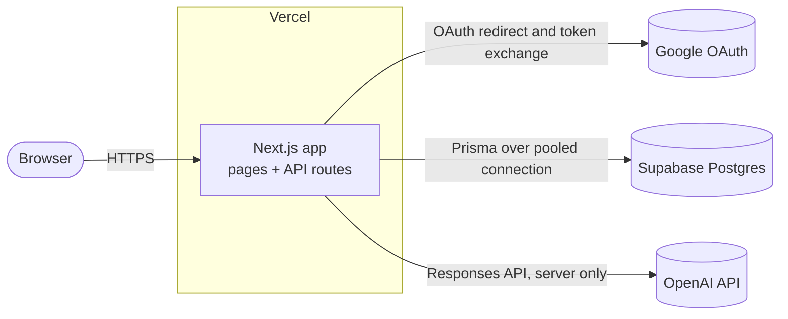
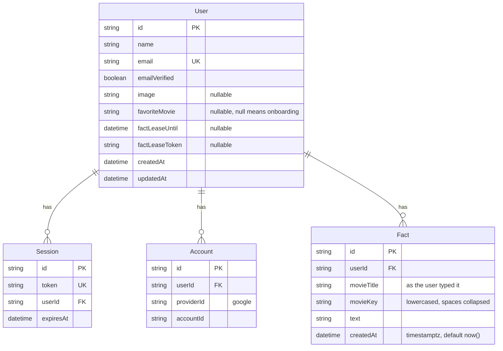
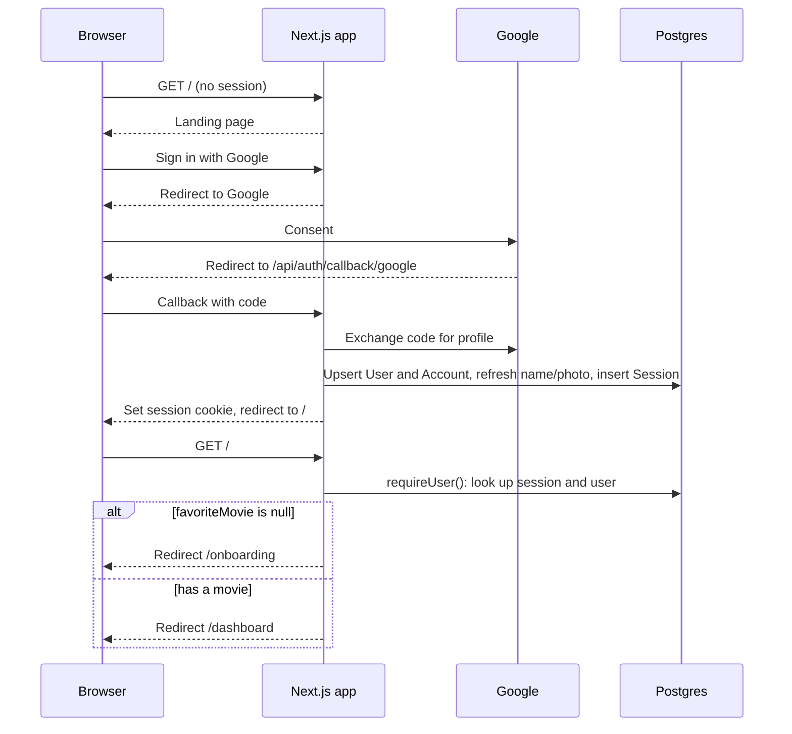
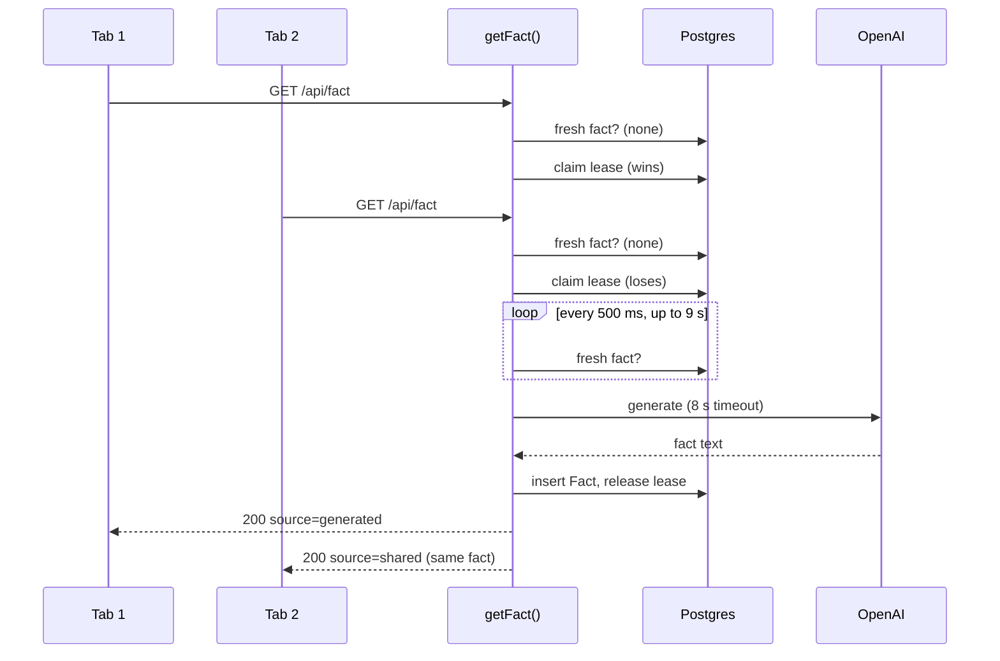
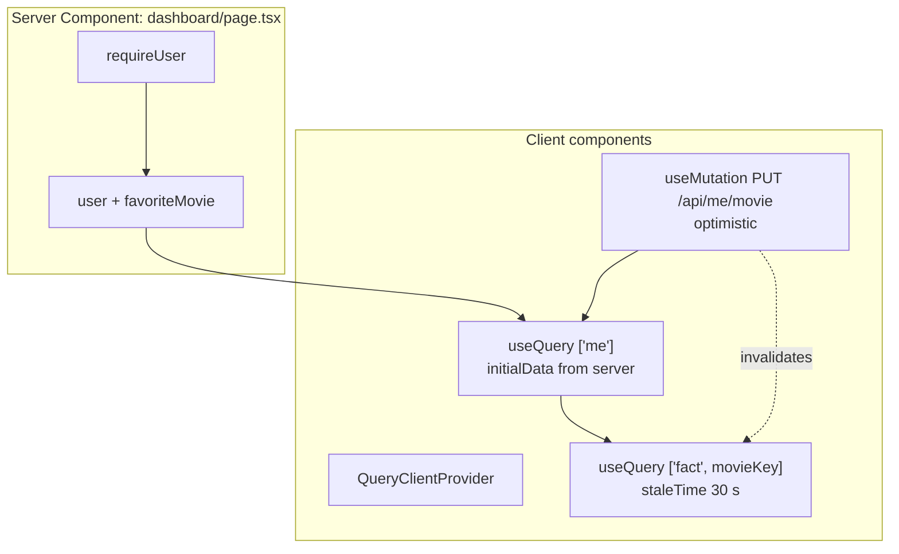
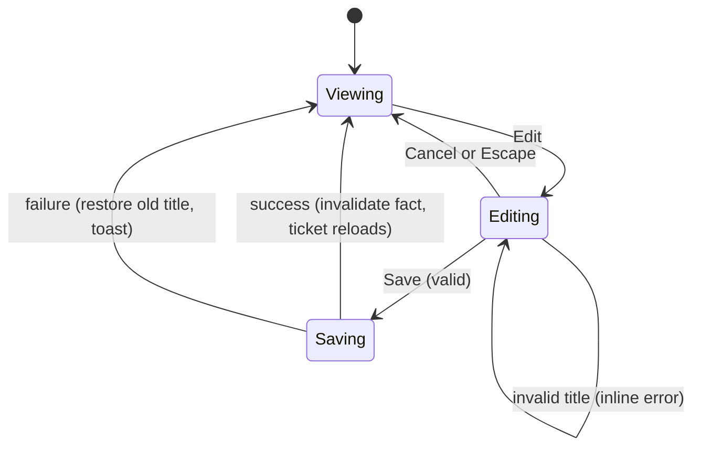

# Architecture: Pandoras Box

Pandoras Box is a single Next.js app. A user signs in with Google, saves one favorite movie, and sees a dashboard with an AI-generated fact about it. This document describes how the pieces fit together. The reasons behind each choice are in [design-decisions.md](design-decisions.md), cited below as D1, D2 and so on.

## 1. System context



The browser talks only to our app. Google, Postgres and OpenAI are reached from the server, so no secret ever reaches the client (D3, D15, D24).

## 2. Stack

| Concern | Choice |
|---|---|
| Framework | Next.js App Router, version 16.2.6 or later (earlier versions have the CVE-2026-44575 proxy bypass) |
| Language | TypeScript, strict mode |
| Auth | Better Auth with the Google provider and database sessions (D3, D4) |
| Database | Postgres on Supabase, used as a database only (D24) |
| ORM | Prisma 7 with `@prisma/adapter-pg` |
| AI | OpenAI Node SDK, Responses API, `gpt-5.4-mini` by default (D15) |
| Client data | TanStack Query v5 (D20) |
| Validation | Zod, with schemas shared by server and client (D21) |
| Styling | Tailwind v4, shadcn, Cult UI components restyled to DESIGN.md (D27, D28) |
| Fonts | Bowlby One and General Sans, self-hosted (D29) |
| Tests | Vitest, a real Postgres in Docker, MSW, React Testing Library (D25) |
| Tooling | pnpm, ESLint, Prettier, GitHub Actions (D26) |
| Hosting | Vercel (D24) |

## 3. Code layout

```
app/
  page.tsx                    landing; redirects signed-in users by onboarding state
  onboarding/page.tsx         first-time movie form (redirects away once a movie exists)
  dashboard/page.tsx          profile, movie, fact ticket
  api/auth/[...all]/route.ts  Better Auth handler (Google sign-in, callback, sign-out)
  api/me/route.ts             GET current user
  api/me/movie/route.ts       PUT favorite movie
  api/fact/route.ts           GET fact for the current user's movie
components/                   UI built from Cult UI components restyled to DESIGN.md
lib/
  auth.ts                     Better Auth server config (server only)
  auth-client.ts              Better Auth browser client (sign in, sign out)
  dal.ts                      requireUser() and getCurrentUser() (server only)
  db.ts                       Prisma client on a module-level pg Pool
  movie.ts                    the movie title rule (D10), shared by server and client
  contracts.ts                Zod request and response schemas plus error codes (D21)
  api.ts                      typed browser client for /api/*
  openai.ts                   OpenAI call with timeout and prompt (server only)
  facts.ts                    getFact(): cache, lease, generation, fallback
  query-keys.ts               TanStack Query keys
prisma/
  schema.prisma
  migrations/
prisma7.config.ts
tests/
  backend/                    Variant A tests (real Postgres)
  frontend/                   Variant B tests (MSW + React Testing Library)
design/                       DESIGN.md, mockups, icons
dev-docs/                     planning documents
```

Every file marked "server only" starts with `import "server-only"`, so the build fails if client code ever imports it.

## 4. Data model



- Better Auth owns `User`, `Session`, `Account` and `Verification`, and generates their Prisma models. We add three columns to `User` (D8, D13) and our own `Fact` model (D9).
- `Fact` has an index on `(userId, movieKey, createdAt DESC)`. Both the "fresh fact" lookup and the "latest fact" fallback are a single index range scan.
- Deleting a user cascades to their facts, sessions and accounts.
- All timestamps are `timestamptz` and are written by the database (`now()`), never by app code (D12).

## 5. Auth and access control

### Sign-in and routing



### The one rule

`lib/dal.ts` exports `requireUser()`:

1. It reads the session cookie.
2. It looks the session up in Postgres through Better Auth.
3. It returns the user, or signals "no session".

- **Pages** turn "no session" into a redirect to `/`.
- **API routes** turn it into `401 UNAUTHENTICATED`.

There is no proxy file. Nothing in the app reads user data without going through `requireUser()` first (D5).

### Page guards

| Page | No session | Session, no movie | Session with movie |
|---|---|---|---|
| `/` | Landing | Redirect `/onboarding` | Redirect `/dashboard` |
| `/onboarding` | Redirect `/` | Show form | Redirect `/dashboard` |
| `/dashboard` | Redirect `/` | Redirect `/onboarding` | Show dashboard |

### Ownership

No endpoint takes a user ID (D7). Every query inside `facts.ts` and the movie route filters by the session user's ID, which comes from `requireUser()`. A user can't name someone else's data, so there is nothing to check.

### Logout

Logout calls Better Auth's sign-out:
- It deletes the session row and clears the cookie.
- It sends the user back to `/`.
- Other tabs fail their next request with 401 and redirect (D4, D30).

### Missing profile data

- **Name:** if Google sends no name, the UI shows the part of the email before the @.
- **Photo:** if there is no photo, or it fails to load, the UI shows the user's initials.
- **Refresh:** name and photo are refreshed from Google on each sign-in, using Better Auth's provider option for overriding user info on sign-in. Check the exact option name against the installed version.

## 6. API contract

All endpoints need a session. Request and response bodies are validated with Zod schemas in `lib/contracts.ts`, which are used by both the route handler and `lib/api.ts`.

| Method and path | Request | Success | Errors |
|---|---|---|---|
| `GET /api/me` | none | `200 { id, name, email, image, favoriteMovie }` | 401 |
| `PUT /api/me/movie` | `{ movie: string }` | `200 { favoriteMovie }` | 400 `VALIDATION_ERROR`, 401 |
| `GET /api/fact` | none | `200 { fact: { text, movieTitle, generatedAt }, source, secondsUntilRefresh }` | 401, 409 `ONBOARDING_REQUIRED`, 503 `FACT_UNAVAILABLE` |

- `source` is one of:
  - `cache`: a fact under 60 seconds old.
  - `generated`: just created.
  - `shared`: created by a parallel request this one waited on.
  - `fallback`: an older fact returned because OpenAI failed.
- `secondsUntilRefresh` is how long until the server would generate a new fact. The server computes it from database time, and it is 0 for a `fallback` (D19).
- Every error has the shape `{ error: { code, message, issues? } }`. `issues` appears only on `VALIDATION_ERROR`.
- `name` and `image` may be null, and the UI handles both (D30).

The movie rule in `lib/movie.ts` (D10) runs inside the `PUT` handler before anything touches the database. The browser runs the same rule only to give earlier feedback.

## 7. Fact generation (Variant A)

### Algorithm

`getFact(userId)` in `lib/facts.ts`:

1. **Load** the user's `favoriteMovie`. If it's null, return `ONBOARDING_REQUIRED`. Compute `movieKey`.
2. **Fresh check.** Find the newest fact for `(userId, movieKey)` with `createdAt > now() - interval '60 seconds'`. If found, return it as `cache`.
3. **Claim the lease** with a single statement:
   ```sql
   UPDATE "user"
   SET "factLeaseUntil" = now() + interval '15 seconds', "factLeaseToken" = $token
   WHERE id = $userId AND ("factLeaseUntil" IS NULL OR "factLeaseUntil" < now())
   RETURNING id
   ```
4. **If the claim succeeded:**
   1. Repeat the fresh check, because a parallel request may have finished just before we claimed. If a fresh fact is found, release the lease and return it as `cache`.
   2. Load the latest fact for this movie at any age. It goes into the prompt as "don't repeat this" (D16) and serves as the fallback.
   3. Call OpenAI with an 8-second timeout and no retries.
   4. On success, insert the fact, release the lease, and return it as `generated`.
   5. On failure, release the lease and log the error. Return the latest fact as `fallback` if one exists, otherwise `FACT_UNAVAILABLE`.
5. **If the claim failed** (someone else is generating):
   1. Poll the fresh check every 500 ms for up to 9 seconds.
   2. If a fact appears, return it as `shared`.
   3. If none appears, fall back the same way as 4.5 (D17).

Releasing the lease is `UPDATE "user" SET "factLeaseUntil" = NULL, "factLeaseToken" = NULL WHERE id = $userId AND "factLeaseToken" = $token`. The token check stops a request that ran past its expiry from clearing a newer claim (D13). Release runs in a `finally` block.



### Why this is correct across servers

The lease claim is one atomic `UPDATE` with a condition. Postgres row locking means that only one of several concurrent claims can see an expired or empty lease and set it. The other servers see zero rows updated. No transaction stays open during the OpenAI call, so the connection pool isn't held hostage, and the approach works through Supabase's transaction pooler (D11).

### Timing budget

| Value | Setting | Reason |
|---|---|---|
| Server cache window | 60 s | Brief |
| OpenAI timeout | 8 s | D14 |
| Lease expiry | 15 s | Longer than the OpenAI timeout, so a live holder never loses its lease |
| Waiter polling | every 500 ms, up to 9 s | Covers the holder's 8 s call plus the insert |
| Vercel function duration | at least 15 s | Lets a waiter finish; set in route config |

### OpenAI call

`lib/openai.ts` is server only:
- `instructions` carry the trivia rules (D15).
- `input` carries the title as quoted data and, when present, the previous fact to avoid.
- The output is capped (about 150 tokens), trimmed, and rejected if empty.
- The model comes from `OPENAI_MODEL`.
- The SDK client is created once per module with `timeout: 8000` and `maxRetries: 0`.

### Known limit

Changing the movie skips the cache, so rapid movie changes cost one OpenAI call each. This is documented, not guarded (D18).

## 8. Client (Variant B)

### Rendering split



The server renders the profile and movie right away. The fact loads in the browser behind a skeleton, so OpenAI never delays the page (D22).

### Client cache rules

- `['fact', movieKey]` has `staleTime: 30_000`. Within 30 seconds, mounting the ticket or refocusing the window reuses the cached fact with no request.
- The **New fact** button calls `refetch()`, which always goes to the server. The button is disabled while `secondsUntilRefresh > 0`, and the client counts that down from when the response arrived (D19).
- A **movie change** gives a new `movieKey`, so the old cache entry stops matching. The mutation also invalidates `['fact']` after success.

### Inline edit flow



The mutation follows TanStack's documented recipe:

1. `onMutate`: cancel in-flight `['me']` queries, snapshot the current value, and set the new title.
2. `onError`: restore the snapshot and show the toast "Couldn't save "X". Your favorite is still Y."
3. `onSettled`: invalidate `['me']`.
4. On success, also invalidate `['fact']`.

### Typed client

`lib/api.ts` exposes `api.getMe()`, `api.setMovie(movie)` and `api.getFact()`. A shared `request()` helper:
- calls `fetch`
- parses the JSON with the endpoint's Zod schema
- turns any non-2xx response, network failure or schema mismatch into `ApiError { status, code, message, issues? }`

A 401 anywhere sends the user to `/`.

### UI states

| Surface | Loading | Empty | Error |
|---|---|---|---|
| Fact ticket | Skeleton bars | Not possible after onboarding (a fact always generates or errors) | `fallback` fact with a stale notice, or the error panel with Try again |
| Inline edit | "Saving" with spinner | n/a | Inline validation error, or a toast with the old title restored |
| Onboarding form | Button disabled while saving | Placeholder title | Inline validation error |
| Avatar | n/a | Initials when there's no photo | Initials when the photo fails |

## 9. Failure modes

| Failure | What the user sees | Mechanism |
|---|---|---|
| OpenAI timeout or error, older fact exists | Last fact with "Couldn't get a fresh fact" | Fallback in `getFact` (D14) |
| OpenAI fails, no fact yet | "Couldn't load a fact" with Try again | 503 `FACT_UNAVAILABLE` |
| Two tabs or rapid refresh | Same fact in both, one OpenAI call | Lease plus waiting (D11, D17) |
| Request crashes holding the lease | Next request after 15 s generates normally | Lease expiry |
| Lease holder overruns expiry | Newer claim isn't cleared | Token-checked release (D13) |
| Movie save rejected by server | Old title comes back, toast explains | Optimistic rollback |
| Invalid title | Inline message, nothing saved | Shared rule, enforced server side (D10) |
| Session revoked or expired | Redirect to landing | `requireUser()` on every request |
| Google sends no name or photo | Email prefix or initials | D30 |
| Database connection drops | Generic error, request can be retried | `pg` connection timeout set explicitly; pool reused across invocations |

## 10. Security summary

- **Secrets:** the OpenAI key, Google client secret, Better Auth secret and database URLs exist only in server environment variables. None use the `NEXT_PUBLIC_` prefix, and server-only modules import `server-only`.
- **Authentication:** database sessions in an HttpOnly, Secure, SameSite=Lax cookie, set by Better Auth. Logout deletes the row.
- **Authorization:** identity comes only from the session, and no endpoint accepts a user ID (D7). A backend test asserts that user B can't get user A's facts.
- **Input:** the movie title is validated on the server with a length cap and control-character rejection (D10).
- **Prompt injection:** the title is passed to the model as quoted data, and the output is shown as plain text, never as HTML. The model has no tools and no secrets in its context.
- **Framework:** Next.js 16.2.6 or later.

## 11. Environment variables

| Name | Used by | Notes |
|---|---|---|
| `DATABASE_URL` | App at runtime | Supabase pooled connection string |
| `DIRECT_URL` | Prisma migrations | Supabase direct connection string |
| `BETTER_AUTH_SECRET` | Better Auth | Random 32+ byte string |
| `BETTER_AUTH_URL` | Better Auth | App base URL, e.g. the Vercel domain |
| `GOOGLE_CLIENT_ID` | Better Auth | Google Cloud OAuth client |
| `GOOGLE_CLIENT_SECRET` | Better Auth | Google Cloud OAuth client |
| `OPENAI_API_KEY` | `lib/openai.ts` | Server only |
| `OPENAI_MODEL` | `lib/openai.ts` | Defaults to `gpt-5.4-mini` |

The Google OAuth client needs `{BETTER_AUTH_URL}/api/auth/callback/google` registered as a redirect URI for each environment.

## 12. Testing strategy

| Area | Tool | What it proves |
|---|---|---|
| Cache window | Vitest + Docker Postgres | A fact under 60 s is returned without calling OpenAI; a backdated fact over 60 s triggers generation |
| Concurrency | Vitest + Docker Postgres | Five parallel `getFact` calls make exactly one OpenAI call and all return the same fact |
| Failure | Vitest + Docker Postgres | OpenAI error returns the stale fact, or `FACT_UNAVAILABLE` with none |
| Lease recovery | Vitest + Docker Postgres | An expired lease is reclaimed; a stale token can't clear a newer lease |
| Authorization | Vitest + Docker Postgres | Without a session every endpoint returns 401; facts are scoped to the session user |
| API client | Vitest + MSW | 401 and 500 become the right `ApiError`; network errors are normalized |
| Edit flow | Vitest + MSW + React Testing Library | Optimistic title shows, failure restores it, success refetches the fact |

OpenAI is mocked in every test. CI runs the same suite with a Postgres service container (D25, D26).
